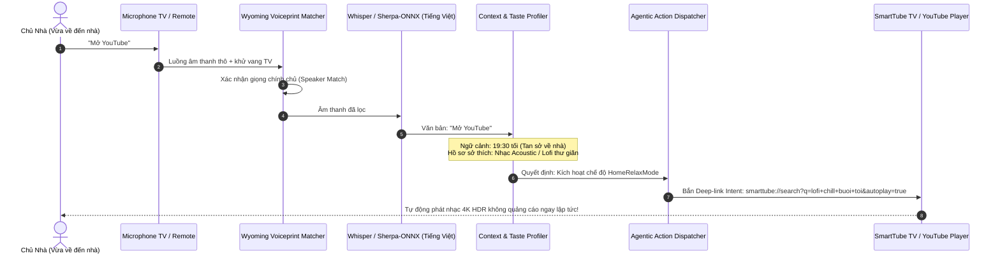

# KIẾN TRÚC TRỢ LÝ GIỌNG NÓI LITEVOICE AGENT
> **Vượt trội hoàn toàn so với Google Assistant**: Hiểu ngữ cảnh sâu • Nhận diện giọng chủ nhà • Tự động hóa chuỗi hành động theo sở thích cá nhân • Hoạt động độc lập không cần Google Play Services

---

## 1. SO SÁNH SỰ VƯỢT TRỘI VỚI GOOGLE ASSISTANT

| Tiêu chí so sánh | Google Assistant trên TV | **LiteVoice Agent (LITEOSTV)** |
| :--- | :--- | :--- |
| **Xử lý lệnh "Mở YouTube"** | Chỉ bật app YouTube lên màn hình chính rồi dừng lại, bắt người dùng phải cầm remote bấm tiếp. | **Agentic Chain**: Bật YouTube/SmartTube -> Phân tích ngữ cảnh buổi tối -> Tự động tìm & phát ngay bài nhạc theo gu sở thích của chủ nhà. |
| **Khả năng hiểu ngữ cảnh** | Không có bộ nhớ thói quen, đối xử mọi lúc như nhau. | **Semantic Memory**: Ghi nhớ thời gian (Sáng/Tối), tâm trạng, lịch sử nghe nhạc và hồ sơ cá nhân của chủ nhà. |
| **Khử tiếng ồn TV (AEC)** | Dễ bị kích hoạt nhầm hoặc điếc khi loa TV đang mở lớn. | **Wyoming + ECAPA-TDNN**: Nhận diện vân giọng chủ nhà (Voiceprint), triệt tiêu hoàn toàn âm thanh phát ra từ TV. |
| **Dung lượng & Tài nguyên** | Ép buộc cài đặt Google Play Services ngốn 300MB - 500MB RAM. | **Siêu nhẹ (<25MB RAM)**, hỗ trợ mô hình nhận dạng giọng nói tiếng Việt on-device (Sherpa-ONNX / Whisper.tflite). |
| **Quyền riêng tư & Mã nguồn** | Đóng kín, gửi âm thanh về máy chủ Google. | **100% Mã nguồn mở**, dữ liệu giọng nói và thói quen nằm trọn vẹn trên TV của người dùng. |

---

## 2. KỊCH BẢN THỰC THI THỰC TẾ: "CHỦ VỀ NHÀ — NÓI 'MỞ YOUTUBE'"



---

## 3. CƠ CHẾ BỘ NHỚ SỞ THÍCH (`UserTasteEngine`)

Mỗi khi người dùng nghe nhạc, xem video hoặc ra lệnh giọng nói, hệ thống tự động cập nhật trọng số sở thích vào cơ sở dữ liệu SQLite cục bộ:

```json
{
  "user_id": "owner_primary",
  "name": "Chủ Nhà",
  "evening_routine": {
    "preferred_app": "com.teamsmart.videomanager.tv",
    "intent_action": "PLAY_MUSIC",
    "default_genres": ["lofi_chill", "acoustic_vietnam", "bolero_relax"],
    "volume_level": 22,
    "display_theme": "theme.liquid-glass.orange"
  },
  "morning_routine": {
    "preferred_app": "vn.vtv.vtvgo",
    "intent_action": "OPEN_CHANNEL_VTV1_HD",
    "volume_level": 25
  }
}
```

---

## 4. DEEP LINK VÀ TỰ ĐỘNG HÓA INTENT

Để thực thi không cần chạm tay vào remote, LiteVoice gửi Intent broadcast trực tiếp xuống tầng OS:

```bash
# Deep-link mở nhạc theo sở thích ngay tức thì trên SmartTube (Không quảng cáo)
am start -a android.intent.action.VIEW \
  -d "smarttube://search?q=nhac+lofi+chill+acoustic+buoi+toi&autoplay=true" \
  -p "com.teamsmart.videomanager.tv"
```
